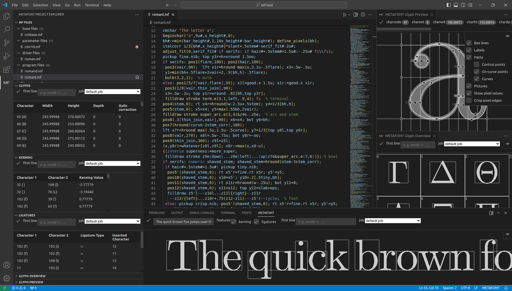

# `vscode-metafont`

A Visual Studio Code extension that provides language, preview and debugging support for METAFONT.

- [`vscode-metafont`](#vscode-metafont)
  - [Installation](#installation)
  - [Features](#features)
  - [Screenshot](#screenshot)
  - [Walkthrough](#walkthrough)
    - [File Management](#file-management)
    - [The *Glyph Preview*](#the-glyph-preview)
    - [The *Font Preview*](#the-font-preview)
    - [Debugging](#debugging)
    - [Commands](#commands)
  - [Motivation and Purpose](#motivation-and-purpose)
  - [Future enhancements](#future-enhancements)
  - [See also](#see-also)
    - [METAPOST focused](#metapost-focused)

## Installation

You can install the extension from within VSCode (ID: `mf2vec-dev.vscode-metafont`).\
Alternatively, you can manually download the `.vsix` file of each release [here](https://github.com/mf2vec-dev/vscode-metafont/releases).

You can also package the extension yourself:
1. clone this repository, change to the new directory
2. `npm install`
3. `vsce package`
4. `code --install-extension vscode-metafont-x.y.z.vsix`

## Features

**Note:** Many features are still under development.

- Language features\
  syntax highlighting, semantic highlighting, hover, code indentation, code folding, token definition, etc.
- METAFONT file management\
  In the *MF Files* view, `.mf` files can be grouped in different categories. Parameter files can be marked as default job file for easy reference in other features.
- Useful commands\
  This extension provides commands to run METAFONT or generate proof sheet PDFs.
- Preview of:
  - Current glyph (glyph preview)\
    Shows a preview of a glyph depending on your caret's (text cursor's) position. You can lock the reference to keep showing a specific glyph when editing other parts of your code.
  - All glyphs (glyph overview)\
    Provides an overview of all glyphs of the font. 
  - Font (font preview)\
    Test the font including kerning and ligatures.
  - Glyph box dimensions (table)\
    Table of all glyph box dimensions
  - Kerning pairs (table)\
    Table of all kerning pairs
  - Ligatures (table)\
    Table of all ligatures

  For all those previews, you can specify a *first line* and a *job file* to preview the output with different parameter files, modes/resolutions, etc. You can also move many previews to separate windows.
- Debugging\
  Set breakpoints to pause METAFONT on a specific line and inspect variables. Besides showing the values of `numeric`, `pair` and `transform` variables, the debugger also provides a visualization of `path` and `picture` variables and expressions.\
  Currently, debugging inside definitions/macros or loops is not supported.

**Note:** The previews should update every time you save a METAFONT file or change a preview option. Note that METAFONT needs to re-run in many cases which might take a few seconds. To speed this up, comment out code you are not working on (e.g. all but one program file `input` in the driver file or characters you are not editing).

## Screenshot

The screenshot(s) may be outdated as they are not updated with every update of the extension.

## Walkthrough

**Note:** This walkthrough should give you an introduction to the main features to get you started with this extension. It assumes a default configuration of VSCode and the extension.

Open the root directory of your font in VSCode to load it as a workspace. The extension is activated by opening a .mf file. This will search for all .mf files and analyze them, e.g. which macros are defined, which file inputs which files, etc.

### File Management
1. In the activity bar (on the far left of the VSCode window by default) you will see an *MF* option. Click it to open the *METAFONT Project Explorer* in the side bar.
2. The top view (MF Files) allows you to group your .mf files into the usual categories (base, parameter, driver and program). If you haven't made any changes yet, all .mf files will be grouped under *unknown category*.
3. Click one of the files (or use shift to select multiple files) and drag and drop them to a category.
4. The *parameter files* category has a special purpose. All files in this category can be selected as the job in previews. Drag and drop one or more of your parameter files into the *parameter files* category.
5. As you hover over the files, a small house icon appears to the right of the file name. You can click it to make that file the *default job*, allowing quick access to that .mf file in previews and commands. You may want to choose a representative or frequently used parameter file as your default job.
6. Since the *default job* is the default selection in the *job* drop-down menus, defining a *default job* will update the other previews in the *METAFONT Project Explorer*, you will see tables of the kerning pairs and  ligature definitions. Furthermore, the *Glyph Overview* shows a small preview of all glyphs.
7. Click the drop-down menu of one of the views and select one of the .mf files you dragged and dropped into the *parameter file* category in step 5. The view updates according to the selected parameter file.
8. To select a different mode, you can use the *first line* input field, e.g. type `mode:=lowres;` and press enter.

### The *Glyph Preview*
1. Open one of your program files and go to the definition of a character, e.g. the definition of `a`. Above the content of the file, to the left of the title bar, click the icon that shows a split square with an A in the right half of the square. The glyph preview opens to the right of your code.
   - Optional (useful if you have a dual monitor setup):\
     Right-click on the tab of the preview and select *Move into New Window*.
2. Basic glyph information is shown in the title bar. Scroll to the right to show the other preview options such as *first line* or the *job* drop-down.
3. The glyph preview shows multiple elements:
   - The Bézier paths with control points calculated by METAFONT. If you draw a grid (e.g. with plain METAFONT's `makegrid`), it is also shown. Note that the paths used in `draw` or similar commands describe the center of the pen.
   - The picture output by the character's `shipout` (usually `currentpicture` is shipped out in `endchar`).
   - The labels defined by `special` commands (usually defined using the `labels`, `penlabels` and `makelabel` macros).
4. The glyph preview depends on the current file and the current cursor position in that file. Move the cursor to the definition (*program*) of another character to get a preview of that character. The paths drawn, filled etc. above the cursor position are shown in high contrast, while paths added to the image below the cursor are grayed out. This allows you to easily identify sections of your code that generate specific parts of your characters. 
5. You can click the *show* lock symbol on the far right of the preview's title bar (you may need to scroll to the right) to save the current cursor position. This allows you to move to other files to change parameters or macros while keeping the glyph in the preview.
6. Click the eye icon in the upper right corner of the preview to open the preview options. You can show or hide
   - box lines, which show the box dimensions of the glyph and are useful when no grid is drawn by the mf code,
   - labels, to find numbered/named points in the preview,
   - paths, for which you can also select to only show or hide
     - the control points,
     - the on-curve points,
     - the curves themselves,
   - pictures, which previews the shipped out picture with the resolution according to the current mode,
   - the value of the pixels (positive are shown in gray, negative in red),
   - crisp pixel edges, which can improve the appearance of pictures when the pixel value is not shown.
7. Click the eye icon again to close the preview options.

### The *Font Preview*
The *Font Preview* is similar to the *Glyph Preview*. Only the specifics are explained here.
1. The *Font Preview* is located in VSCode's panel by default. Open VSCode's terminal to open it. Click the *METAFONT* tab to open the *Font Preview*.
2. Type the text you want to preview in the input field in the title bar and press enter.
3. Select whether you want to use kerning and ligatures in the preview using the check boxes in the preview's title bar.
4. Click on the split square icon with the A on the right half of the square to open the *Font Preview* to the right of your code.

### Debugging
**Note:** Debugging of METAFONT code is still buggy on its own at this time. You may need to run the debugging again if something doesn't work.
1. Open one of your program files (where you define a character). Move your mouse over a line number. A red circle appears to the left of the line number. Click the circle to set a break point on that line.
2. Open *Run and Debug* in the side bar. By default, the Debug configuration is selected to debug your *default job*. Click the green play button to run it in debug mode. The debug toolbar appears.
3. The execution should pause at the breakpoint defined in step 1.
4. When paused, the sidebar shows:
   - a list of all numeric, pair and transform variables with their values. If the value of a variable is unknown, it's name or an equation is shown, e.g. `x1r: x1+0.75`
   - a list of all watched variables or expressions. This list is empty by default. Click the *+* button next to *Watch* to add expressions of any type.
   - the call stack, showing which file the debugger is are currently in and how the debugger got there (which `input` command it stepped into).
   - a list of all breakpoints.
   - the expression preview to preview path and picture expressions.
5. In the toolbar you can choose how to proceed:
   - continue to the next breakpoint or to the end.
   - step line by line,
   - step into an `input` file,
   - step out of the current file,
   - restart debugging,
   - stop debugging.

   When the debugging is paused again, the variables and watched expressions in the side bar are updated.

### Commands
1. Open the VSCode's Command Palette (Ctrl+Shift+P)
2. Type `proof sheets` and select the command to generate proof sheets for the default job.
3. A PDF is generated by METAFONT, gftodvi and dvipdf. It opens to the right side. (Make sure that VSCode can open PDF files. You may need an extension to open PDFs in VSCode.)

## Motivation and Purpose

While METAFONT provides an interface for `display`ing characters, it's author acknowledges that other programs are helpful in creating a good font:

> [...] a font must be seen to be believed. Moreover, if some characters of a font are faulty, the best way to fix them is to look at diagrams that indicate what went wrong. Therefore METAFONT is incomplete by itself; additional programs are needed to convert the output of METAFONT into graphic form.
>
> &mdash; <cite>Donald E. Knuth, The METAFONTbook, p. 327</cite>

In appendix H of The METAFONTbook, Donald E. Knuth discusses two programs, `GFtoDVI` and $\TeX$, to generate proof sheets. While these are great for generating *large scale proofs* and *font samples*, you may want to get a more detailed view of a character's anatomy while designing it. This was the original motivation for this extension.

The development of this extension started in 2019, with the preview based on the `mf2vec` concept (see [the explanations in `mf2ff`'s README](https://github.com/mf2vec-dev/mf2ff?tab=readme-ov-file#mf2vec-concept)). Starting in October 2023, some parts of the extension were re-implemented and many features were added. While it is relatively easy to use METAFONT as an interpreter to provide previews as a special feature of a language extension, it is much more difficult to correctly implement standard language features such as syntax highlighting, semantic highlighting, go to definition, etc. due to the flexibility of the METAFONT language, e.g. `a.b` can be a variable or the use of a macro that takes an undelimited parameter. The macro could be defined in another file that the current file doesn't reference. In other languages you have to `import` everything you want to use. In METAFONT it is much harder to know where and how a symbolic token was defined. Therefore these basic language features may not be as robust as you are used to in other languages.

The developer of this extension hopes that it will help font designers to design and debug fonts and glyphs more easily. Although this may not be an ideal solution, it could be a small step towards Dave Crossland's vision to help METAFONT to catch on:
> Perhaps if there was a graphical user interface to visualize METAFONT code in near real-time, type designers who feel writing code is unintuitive could be more confident about doing so.
>
> &mdash; <cite>Dave Crossland, Why didn't METAFONT catch on?, TUGboat, Volume 29 (2008), No. 3, p. 419</cite>

## Future enhancements

- Code quality\
  This is my first big TypeScript/JavaScript/Node.js project so I'm new to this ecosystem. I hope to learn more and improve the code quality and test coverage along the way. Anyone with more experience is welcome to fix obvious flaws or discuss potential improvements.
- Fixes and improvements\
  There is still a lot of room for improvement in some of the language features, both in terms of functionality and performance.
  There are some major and many minor bugs in the debugger.
  The GUI of the previews could also be improved.
- Better efficiency and speed\
  Running METAFONT less frequently for previews and updating them based on unsaved files, may allow for near real-time previews.
- Notebook-like METAFONT interface [maybe]\
  This might be useful for learning METAFONT, experiments, etc. with included interactive output of evaluated expressions, paths, pictures and maybe more.
- Interactive function testing [maybe]\
  It would be great to be able to test macros interactively, e.g. move around points passed as input (pair value or point suffix) and see how a computed path or filled/drawn picture changes.
- Interactive editing [maybe]\
  This is more challenging, and I'm not sure how it could be done. In many cases, METAFONT's result is based on a combination of parameters, equations, factors or even numerical solutions of nonlinear equations. When the user modifies the visualization, what should be changed? A mechanism to specify what should be changed may be too complicated and some constraints may not be met during editing in the visualizations.

## See also

- [mfcode](https://github.com/CharlesAverill/mfcode) a VSCode extension for METAFONT
- [meta-mode](https://ctan.org/pkg/meta-mode) a GNU Emacs editing mode for METAFONT and METAPOST code by Ulrik Vieth ([TUGboat article](https://www.tug.org/TUGboat/tb18-1/tb54viet.pdf))
- [MetafontMode](https://alphacocoa.sourceforge.io/MetafontModeHelp.html) for the Alpha text editor
- [MetaPreview](https://www.winedt.org/macros/latex/MetaPreview.html) for easy PDF generation within WinEdt editor
- [visualmetafont](https://github.com/DigitalKhatt/visualmetafont)
- [Metaflop](https://www.metaflop.com)
- [Metapolator](http://metapolator.com/)
- [metaforge](https://github.com/w4v3/metaforge) a FontForge plugin

### METAPOST focused

- [vscode-metapost](https://github.com/fjebaker/vscode-metapost)
- [MEPer](https://cseweb.ucsd.edu/~s1pan/MEPer/) ([CTAN](https://ctan.org/pkg/meper))
- [MPEdit](https://ctan.org/pkg/mpedit)
- [MetaPost Previewer](http://www.tlhiv.org/mppreview/)
- [Metagraf](http://w3.mecanica.upm.es/metapost/metagraf.php)
